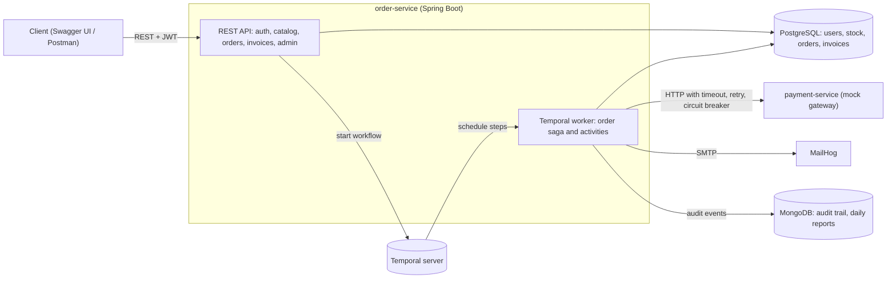
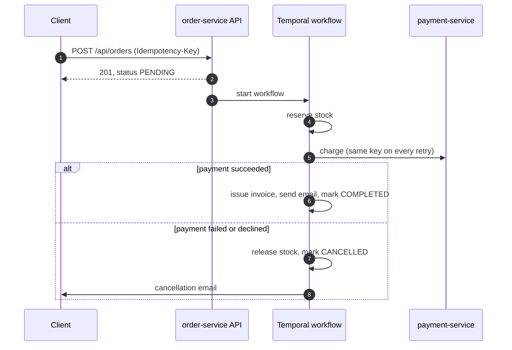
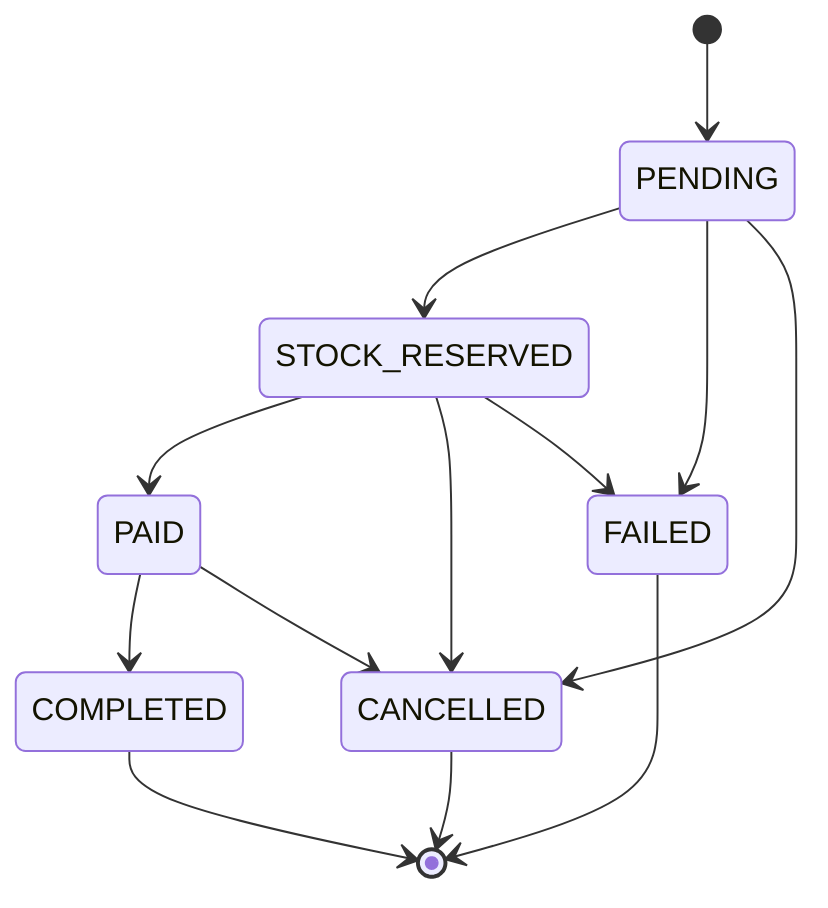

# OrderFlow

[](https://github.com/ajaykum95/orderflow/actions/workflows/ci.yml)


**A production-style order-to-cash backend.** A customer places an order; the system reserves stock, takes payment, issues a GST invoice (PDF) and emails it. If any step fails, everything already done is rolled back automatically, and the customer is told.

Built with Java 21, Spring Boot, Temporal, PostgreSQL, MongoDB and Resilience4j.

> Independent portfolio project. All data is mock; the payment gateway is simulated. No employer or client code is included.

---

## What this demonstrates

| Capability | How it is shown |
|---|---|
| **Workflow orchestration with automatic rollback (saga)** | Order steps run as a [Temporal](https://temporal.io) workflow; on failure, completed steps are undone in reverse order (refund first, then stock) |
| **Configurable workflow** | The step list comes from config (`app.workflow.steps`), not code. Drop `INVOICE` for a client who doesn't need one |
| **Resilience against a flaky payment provider** | Timeouts, retries with exponential backoff and a circuit breaker; the mock gateway can be made to fail or slow down on demand |
| **No double charges, no duplicate orders** | `Idempotency-Key` on order creation; the same key is reused on every payment retry |
| **No overselling** | Stock is decremented with a single conditional SQL update; a test fires 12 concurrent buyers at 5 items |
| **Correct invoicing** | Tax-inclusive GST breakdown from config, gap-free sequential invoice numbers per financial year, PDF output |
| **Audit trail and reporting** | Every order event is recorded in MongoDB; a daily sales report is generated on a schedule |
| **Security** | JWT auth, roles, ownership checks (other users get 404, not 403), tamper and role-forgery tests |
| **Quality** | Unit tests plus integration tests against real Postgres, MongoDB and Temporal (Testcontainers), CI on every push |

## Architecture



### What happens when an order is placed



The API answers immediately with `PENDING`; the workflow runs in the background and the order moves through its states:



`FAILED` means the order never got far enough to need a rollback (for example, not enough stock). `CANCELLED` means something had been done and was undone.

## Tech stack

| Area | Technology |
|---|---|
| Language / framework | Java 21, Spring Boot 3.5, Spring Security (JWT), Spring Data JPA / MongoDB |
| Workflow | Temporal (Java SDK, Spring Boot starter) |
| Resilience | Resilience4j (circuit breaker, retry) |
| Data | PostgreSQL 16 (orders, stock, invoices), MongoDB 7 (audit, reports) |
| Invoices | OpenPDF |
| Email (dev) | MailHog |
| API docs | springdoc-openapi (Swagger UI), Postman collection |
| Tests | JUnit 5, Mockito, AssertJ, Testcontainers, Awaitility, MockWebServer |
| CI / quality | GitHub Actions, JaCoCo |
| Load testing | k6 |

## Quick start

Requirements: Java 21, Maven 3.9+, Docker.

```bash
# 1. Infrastructure: PostgreSQL, MongoDB, Temporal, MailHog, Redis
docker compose up -d

# 2. Mock payment gateway (new terminal)
cd payment-service && mvn spring-boot:run

# 3. The main service (new terminal)
cd order-service && mvn spring-boot:run
```

| What | URL |
|---|---|
| Swagger UI (try the API) | http://localhost:8080/swagger-ui.html |
| Temporal UI (see every workflow step) | http://localhost:8233 |
| MailHog (see the emails sent) | http://localhost:8025 |

> PostgreSQL is exposed on port **5433** and MongoDB on **27018**, deliberately not the defaults, so they don't clash with local installations. See `docker-compose.yml` and `application.yml`.

### Try it in two minutes

1. In Swagger UI: `POST /api/auth/register`, then `POST /api/auth/login`. Copy the token and click **Authorize**.
2. Registration always creates a customer. To get an admin, promote one user once, then log in again:
   ```bash
   docker exec -it orderflow-postgres-1 psql -U orderflow -d orderflow \
     -c "update users set role='ADMIN' where email='admin@example.com';"
   ```
3. As admin: `POST /api/admin/products` to create a product.
4. As customer: `POST /api/orders` (send any unique `Idempotency-Key`), then `GET /api/orders/{id}` until it shows `COMPLETED`.
5. Fetch the invoice: `GET /api/orders/{id}/invoice/pdf`. The email, with the PDF attached, is in MailHog.
6. Open the workflow in the Temporal UI, and `GET /api/admin/audit/orders/{id}` for the order's full history.

Prefer Postman? Import [`postman/OrderFlow.postman_collection.json`](postman/OrderFlow.postman_collection.json). It saves tokens and ids automatically and has the failure demos built in.

## API overview

Full, interactive documentation: Swagger UI (above). Every response uses the same envelope: `success`, `status`, `message`, `data`, `errors`, `timestamp`.

| Area | Endpoint | Access |
|---|---|---|
| Auth | `POST /api/auth/register`, `POST /api/auth/login` | public |
| Catalog | `GET /api/products`, `GET /api/products/{id}` | public |
| Catalog | `POST /api/admin/products`, `PUT` and `DELETE /api/admin/products/{id}` | admin |
| Orders | `POST /api/orders` (header `Idempotency-Key` required) | customer |
| Orders | `GET /api/orders`, `GET /api/orders/{id}` | owner or admin |
| Invoices | `GET /api/orders/{id}/invoice`, `GET /api/orders/{id}/invoice/pdf` | owner or admin |
| Audit | `GET /api/admin/audit/orders/{id}` | admin |
| Reports | `POST` / `GET /api/admin/reports/daily?date=YYYY-MM-DD`, `GET .../range` | admin |
| Diagnostics | `GET /api/admin/payments/circuit` (circuit breaker state) | admin |

## Demo scenarios

The mock gateway has remote controls on port 8081 (`GET` / `PUT /api/chaos`).

| Try this | What you will see |
|---|---|
| Normal order | `PENDING`, then `COMPLETED`. Stock reduced, invoice issued, email in MailHog |
| Send the same `Idempotency-Key` twice | Second call returns `200` with the **same** order; stock reduced once, charged once |
| Order total above INR 100,000 | Payment declined, then `CANCELLED`, stock restored, cancellation email |
| Order more than is in stock | `FAILED`; the payment step is never reached |
| `PUT /api/chaos {"failureRate":1.0}`, then order | Retries, circuit breaker opens, order ends `CANCELLED`, stock restored |
| `PUT /api/chaos {"slowRate":1.0,"slowDelayMs":3000}`, then order | Calls time out and are retried with the same key; no double charge |
| Stop `order-service` while an order is retrying, then restart | The workflow resumes where it stopped and the order completes |

## Design decisions

| Problem | Decision | Why |
|---|---|---|
| Customer double-clicks "Order" or the network drops | `Idempotency-Key` plus a unique `(customer, key)` constraint | Safe to retry; two simultaneous identical requests still create one order |
| Gateway times out but actually charged the card | Same key sent on every retry (`order-{id}-charge`) | The gateway returns the original result instead of charging again |
| A step fails halfway | Temporal saga with compensation in reverse order | Each step is undone only if it had happened; state survives crashes |
| Temporal re-runs a step after a crash | Every step checks the order's state first | Re-running is harmless: no double stock deduction, no second invoice number |
| Retrying a payment the bank has declined | Technical failures (5xx, timeout) are retried; business declines are not | Retrying a decline cannot change the answer |
| Two buyers, one item left | One SQL statement: `update ... set stock = stock - n where stock >= n` | The check and the change are atomic |
| Invoice numbers must have no gaps | Counter row locked with `SELECT ... FOR UPDATE` in the same transaction as the invoice | A failed invoice releases its number; a database sequence would leave gaps |
| Email provider is down | Email is best-effort: retried, then logged, never rolls back a paid order | Not sending an email is not a reason to refund a customer |
| Audit store is down | Audit writes never fail the order | Business flow first; the cost is that events during an outage are lost (see limitations) |
| Leaking which orders exist | Another user's order returns 404, not 403 | Existence is not revealed |

## Testing

| What | Command | Needs Docker |
|---|---|---|
| Fast unit tests | `cd order-service && mvn test` | no |
| All tests plus coverage | `cd order-service && mvn verify` | yes |
| Mock gateway tests | `cd payment-service && mvn verify` | no |

- **Unit tests** (`*Test.java`): order state rules, tax maths, invoice numbering, JWT (including tampering and role forgery), email logic.
- **Integration tests** (`*IT.java`): real PostgreSQL, MongoDB and Temporal in Docker via Testcontainers; only the payment gateway is faked, so tests can break it on demand.
- Coverage report: `order-service/target/site/jacoco/index.html`. CI runs everything on each push and keeps the report as a build artifact.

## Performance

Measured with [k6](https://k6.io). The test mixes read traffic with real checkouts: each simulated order goes through the whole workflow, and the script polls until it is `COMPLETED`.

```bash
# system running, gateway healthy, an admin user exists (see "Try it")
k6 run -e ADMIN_EMAIL=admin@example.com -e ADMIN_PASSWORD=password123 k6/order-flow.js
```

Results are written to `k6/results/summary.md`.

**Test environment:** _(fill in: CPU, RAM, OS; all services and containers ran on the same machine)_

| Metric | Value |
|---|---|
| Load | _(fill in)_ |
| Requests per second | _(fill in)_ |
| Browse products p95 | _(fill in)_ |
| Create order (API response) p95 | _(fill in)_ |
| Orders fully completed per second | _(fill in)_ |
| Order end-to-end (create to COMPLETED) p95 | _(fill in)_ |
| Failed requests | _(fill in)_ |

_Numbers from a single development machine with everything running on it; they show the shape of the system, not production capacity._

## Project structure

```
orderflow/
├── docker-compose.yml          PostgreSQL, MongoDB, Temporal, MailHog, Redis
├── order-service/              main application
│   └── src/main/java/com/orderflow/order/
│       ├── auth/               register, login, JWT, security rules
│       ├── catalog/            products and stock
│       ├── order/              orders, idempotency, state rules
│       ├── payment/            payment provider interface, circuit breaker, retry
│       ├── workflow/           Temporal workflow, activities, rollback
│       ├── invoice/            tax, numbering, PDF
│       ├── notification/       emails
│       ├── audit/              audit trail (MongoDB)
│       ├── report/             daily sales report (MongoDB)
│       └── common/             response envelope, error handling, OpenAPI
├── payment-service/            mock payment gateway with failure injection
├── postman/                    Postman collection
├── k6/                         load test
└── .github/workflows/ci.yml    CI
```

## Configuration highlights

| Setting | Purpose |
|---|---|
| `app.workflow.steps` | Order of workflow steps (`RESERVE_STOCK`, `PAYMENT`, `INVOICE`, `NOTIFY`); validated at startup |
| `app.invoice.tax-rules` | Tax lines, for example one GST line, or CGST plus SGST |
| `app.invoice.seller-*` | Seller name, address, GSTIN printed on invoices |
| `app.report.daily-cron` | When the daily report is generated (India time) |
| `resilience4j.*` | Circuit breaker and retry tuning for the payment provider |
| `payment.chaos.*` (payment-service) | Failure and slowness of the mock gateway |

## Known limitations and roadmap

Stated plainly, because they are real trade-offs:

- **Payment is simulated and synchronous.** A real provider uses a hosted checkout and a webhook. Planned: an `AWAITING_PAYMENT` state, a webhook, and a Temporal signal with a timeout.
- **Redis is provisioned but not used yet.** Product reads are not cached. Planned: cache the product list, and compare against the k6 numbers above.
- **Audit events can be lost during a MongoDB outage.** A transactional outbox would make them durable.
- **If Temporal is down when an order is created, the order stays `PENDING`.** The same outbox idea would fix it.
- **A charge whose response never arrives (all retries time out) cannot be refunded automatically**, because the payment id is unknown. Real systems reconcile with the provider.
- **No credit notes.** A cancelled order after an invoice was issued should produce a credit note rather than leave the invoice standing.
- **The daily report groups by order creation date**, not completion date.
- **Emails that fail after all retries are not re-sent later.**
- The Temporal server in `docker-compose.yml` is the development server; its history is lost when the container is removed.
- `payment-service` has no authentication; it is an internal mock.
